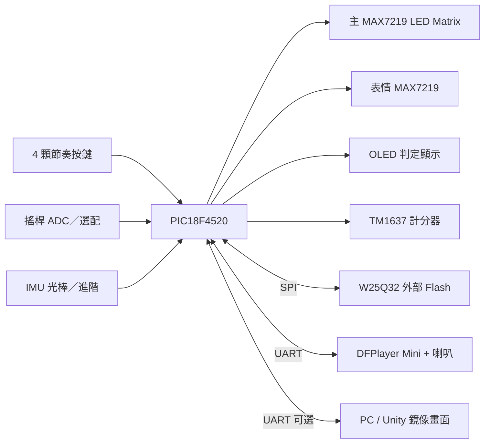
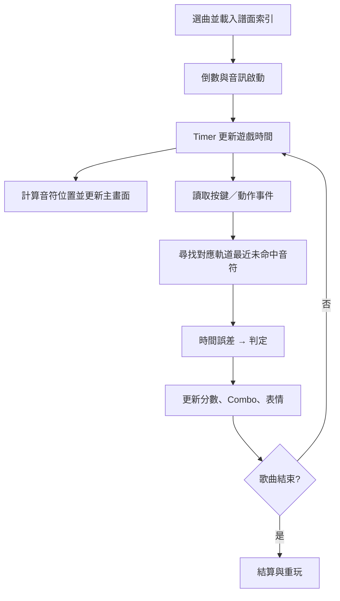

# PIC18F4520 音樂節奏遊戲機｜專題規劃 README

> **狀態：提案草案 v0.1（2026-11-17）**  
> 主控限定 PIC18F4520；不使用其他開發板取代主控。以下成本為**粗估預算，非即時報價**；實際規格、供貨與課程允許的模組需確認。


> 上圖為**概念示意，非已完成的實體作品或最終電路圖**。圖中部分器材型號、價格與日期僅供示意，**以本 README 的文字規劃為準**。

## 1. 專題定位與遊戲體驗

**目標**：打造可現場操作的音樂節奏遊戲機。玩家選曲後，主畫面顯示落下音符，依節奏按鍵或揮動控制棒；PIC18F4520 依輸入時刻與預設譜面比對，給出 **Perfect / Good / Bad / Miss**，更新分數、連擊及機器人表情，最後顯示結算成績。

**基本操作流程**：開機自檢 → 選曲／選難度 → 倒數 → 播放音樂並顯示音符 → 玩家輸入 → 判定、音效與表情回饋 → 結算／重玩。

### 三種遊戲呈現版本（先選一個作為 MVP）

| 版本 | 主遊戲畫面 | 輸入方式 | 可行性／建議 |
|---|---|---|---|
| **MVP：純 PIC 獨立機台** | 4 個 8×8 MAX7219 點陣模組串接，顯示 4 軌音符 | 4 顆按鍵 | **首選**；容易驗證 PIC 真正負責遊戲邏輯 |
| 加強版：多螢幕機台 | 主點陣＋8×8 表情＋OLED 判定＋4 位數計分 | 按鍵＋搖桿 | 展示效果較好，注意 I/O 與更新排程 |
| 進階版：動作節奏機 | 同上 | IMU 感測器光棒（有線） | 有創新性，但方向判斷與時序校正風險較高 |

**Unity 備選**：若使用 Unity（不是「Unite」）在電腦繪製遊戲畫面，必須先確認老師是否接受「PC 顯示＋PIC18F4520 負責核心判定」的架構。若評分重點是 PIC 周邊實作，**不應讓 Unity 取代 PIC 的計時、判定與計分**。可將 Unity 作為加分的鏡像畫面，不作為基本版依賴。

### 介面規劃

- **主顯示器**：四條音符軌道、命中線、倒數；最小可行版以單色點陣為主。
- **第二顯示器**：OLED 文字 `PERFECT / GOOD / BAD / MISS`；也可先在主點陣以簡化符號替代。
- **第三顯示器**：四位數 7-segment 顯示分數或 Combo（需要切換模式）；高分數可改用 OLED。
- **表情顯示器**：8×8 LED Matrix，依 Perfect／Good／Miss 顯示開心、普通、難過表情。
- **輸入**：四顆 Arcade 按鍵；搖桿用於選單；進階使用 IMU 光棒揮動辨識。

## 2. PIC18F4520 技術對應

| 課程單元 | 具體功能 | 是否計入基本版 |
|---|---|---|
| **Timer** | 1 ms 或其他固定 tick、譜面時基、判定時間差 | 必須 |
| **Interrupt** | Timer ISR、按鍵事件（依腳位選擇 INTx 或 PORTB change） | 必須 |
| **SPI** | MAX7219 點陣模組；可與 Flash 分別使用 CS，注意模組特性 | 必須 |
| **UART** | MP3 模組控制或與 PC/Unity 傳輸遊戲事件 | 推薦 |
| **ADC** | 搖桿類比方向／音量旋鈕 | 選配 |
| **PWM** | PIC CCP 輸出蜂鳴器音調或燈光控制 | 選配 |

> PIC18F4520 約有 32 KB 程式 Flash、1.5 KB RAM。**外部 SPI Flash 能存歌曲譜面、圖片與動畫資料，但不會直接增加 PIC 的可執行程式記憶體或 RAM**。PIC 應分段讀取資料，不能將整個大型檔案一次載入。

### 系統架構



**SPI 設計注意**：MAX7219 使用類 SPI 的單向資料介面與 LOAD/CS，可多顆串接；W25Q32 是標準 SPI Flash。若共用 SCK/MOSI，須規劃獨立 CS、讀取時序及 MAX7219 LOAD 的控制。PIC18F4520 僅有一組 MSSP，I²C OLED／IMU 與硬體 SPI 同時使用時，需採軟體 I²C、改用 SPI 版本元件或重新分配介面。**3.3V Flash／IMU 與 5V PIC 之間要確認電壓相容與電平轉換**。

## 3. 設備需求、數量、預算及取得方式

以下是**規劃用區間**，非經查證的即時庫存或成交價格。搜尋時請核對驅動 IC、電壓、模組接腳、是否含排針及尺寸。優先購買台灣電子材料商（如 iCShop、飆機器人、廣華電子、洋天科技）或蝦皮／露天的規格明確賣家；也可用 DigiKey、Mouser 查 IC 規格。請以商品頁及 datasheet 為準。

| 品項 | 建議規格 | 數量 | 單價粗估 NT$ | 小計 NT$ | 搜尋／取得方式 | 階段 |
|---|---|---:|---:|---:|---|---|
| PIC 主控 | PIC18F4520 開發板／學校既有板 | 1 | 0（借用）～800 | 0～800 | 學校／電子材料商 | 必須 |
| 主畫面 | MAX7219 8×8 LED Matrix 模組 | 4 | 50～120 | 200～480 | 搜尋 `MAX7219 8x8 模組` | 必須 |
| 節奏按鍵 | 大型 Arcade 按鍵 | 4 | 25～70 | 100～280 | 搜尋 `Arcade 按鈕 24mm` | 必須 |
| 音訊播放 | DFPlayer Mini（UART） | 1 | 60～160 | 60～160 | 搜尋 `DFPlayer Mini` | 必須* |
| 喇叭 | 4Ω／8Ω，匹配模組輸出 | 1 | 40～120 | 40～120 | 電子材料商 | 必須* |
| microSD | 8～32 GB、相容格式 | 1 | 100～250 | 100～250 | 記憶卡通路 | 必須* |
| 判定畫面 | 0.96 吋 I²C OLED（SSD1306 類） | 1 | 70～180 | 70～180 | 搜尋 `SSD1306 OLED` | 選配 |
| 表情畫面 | MAX7219 8×8 LED Matrix | 1 | 50～120 | 50～120 | 同上 | 選配 |
| 計分畫面 | TM1637 四位數顯示器 | 1 | 35～90 | 35～90 | 搜尋 `TM1637` | 選配 |
| 選單控制 | 雙軸搖桿模組 | 1 | 30～80 | 30～80 | 搜尋 `PS2 搖桿模組` | 選配 |
| 外部記憶體 | W25Q32 SPI Flash **含 3.3V 相容介面** | 1 | 40～150 | 40～150 | 搜尋 `W25Q32 SPI Flash 模組` | 進階 |
| 動作輸入 | MPU6050 IMU | 1 | 50～150 | 50～150 | 搜尋 `MPU6050 GY-521` | 進階 |
| 電平轉換 | 5V↔3.3V 邏輯轉換器 | 1～2 | 20～80 | 20～160 | 電子材料商 | 視電路 |
| 電源與配線 | 穩壓電源、麵包板、線材、電阻 | 1 批 | 150～450 | 150～450 | 電子材料商 | 必須 |
| 機台外殼 | 紙板／壓克力／3D 列印 | 1 | 100～500 | 100～500 | 校內設備／加工 | 選配 |

**預算估算**：核心 MVP（借用 PIC，4 塊 Matrix、4 鍵、DFPlayer、喇叭、microSD、基本電源）約 **NT$650～1,740**；加入全部選配與機構可能超過 **NT$3,000**。價格需於採購前重新詢價。

\*若課程不允許 DFPlayer 類型解碼模組，可先以 PIC PWM／蜂鳴器產生簡單旋律與節拍，後續再討論音訊播放方案。DFPlayer 使用 microSD 不等於 PIC 自己實作 SPI SD 卡存取。

### 外部記憶體是否需要？

- **MVP 不一定需要**：將少量譜面編碼成 PIC 程式 Flash 常數表，逐筆取出即可。
- **建議加分**：W25Q32（32 Mbit = 4 MiB）透過 SPI 儲存多首譜面、角色表情點陣與小動畫。外部記憶體需支援 3.3V，與 5V PIC 接線時需電平轉換。
- **音樂本體**：MP3 存在 DFPlayer 使用的 microSD；PIC 只送播放命令。若要 PIC 直接讀取 SD，需自行實作 SPI／檔案系統及合適音訊輸出方案，難度明顯增加。
- **資料格式範例**：`song_id, BPM, note_count, {time_ms, lane, type}[]`；實作時可改為 16-bit 時間 tick、位元遮罩與差分時間節省空間。

## 4. 核心遊戲邏輯

### 判定與計分（初始參數，待實測校正）

```text
error_ms = abs(input_time_ms - target_note_time_ms)
0–50 ms      PERFECT → +1000 分
51–100 ms    GOOD    → +600 分
101–160 ms   BAD     → +200 分
>160 ms      MISS    → +0 分
```

- **判定必須同時符合軌道與時間**；同一音符只能命中一次。
- `MISS` 應在音符判定視窗過期後自動產生，不能只在玩家按錯時才觸發。
- Combo 規則：Perfect／Good 延續連擊；Bad／Miss 歸零（可調整）。
- 需處理**按鍵去彈跳**（例如 10–20 ms）、長按重複觸發、同時按鍵及歌曲播放延遲校正。
- Timer ISR 僅更新時基與旗標；**不要在 ISR 中進行大量 SPI 更新或長時間等待 UART**。

### 譜面與顯示同步



**音訊同步風險**：DFPlayer 接收 UART 指令後不會保證零延遲播放；建議先量測播放起始延遲並設定 offset，且盡量避免遊戲中途反覆重新播放。若改為 Unity 播放音樂，必須明確定義 PC 與 PIC 之間誰是主時鐘。

### 光棒動作輸入（進階）

1. 初版以**有線 IMU** 固定在棒上，避免無線通訊與電池增加風險。
2. 先辨識左右揮動／加速度峰值，再增加方向與節奏判定。
3. MPU6050 加速度與陀螺儀不能直接提供可靠的絕對空間軌跡；若要真正追蹤位置，需要額外定位方法。
4. 動作判定事件要附上 PIC 時戳，並校正感測與濾波延遲。

## 5. 完整開發流程與 Deadline

> **以下以專題啟動日 T0 起算的 12 週規劃，非已知課程截止日期。** 實際日期確定後再替換。每階段以可展示、可測試的成果為驗收標準。

| 階段 | Deadline | 主要工作 | 必須完成的驗收條件 | 負責角色 |
|---|---|---|---|---|
| 0：需求與採購 | T0＋7 天 | 確認課程限制、硬體清單、接腳表、採購 | 一頁提案、BOM、風險表 | 全員／整合 |
| 1：顯示＋按鍵 | T0＋21 天 | MAX7219 連接、按鍵偵測、Timer | 音符以固定速度下落；四鍵事件可記錄 | 顯示／遊戲 |
| 2：節奏核心 | T0＋35 天 | 譜面格式、時間判定、Combo、分數 | 內建 1 首測試譜面，可判 Perfect／Good／Bad／Miss | 遊戲 |
| 3：音訊整合 | T0＋49 天 | UART 控制 MP3、播放同步、偏移校正 | 連續播放一首歌，音符與節拍可校準 | 音訊／整合 |
| 4：第二／第三畫面 | T0＋63 天 | OLED 判定、表情、計分器 | 每次命中同步更新至少兩種回饋 | 顯示 |
| 5：外部儲存／選單 | T0＋70 天 | SPI Flash 譜面、多曲選單、難度 | 至少 2 首譜面切換；斷電重開可讀取 | 音訊／儲存 |
| 6：進階輸入 | T0＋77 天 | 搖桿或 IMU 光棒（擇一） | 輸入可觸發判定；按鍵版本仍可使用 | 遊戲／硬體 |
| 7：整合與優化 | T0＋84 天 | 壓力測試、UI、外殼、Demo | 完整演示 3 分鐘；無當機；完成文件與影片 | 全員 |

### 里程碑／Go–No Go 決策

- **第 3 週**：若 LED Matrix 無法穩定更新，先降低畫面複雜度，不增加第二顯示器。
- **第 5 週**：若判定系統不穩，先暫停所有外觀與動畫工作。
- **第 7 週**：若 MP3 同步延遲難以校準，先使用蜂鳴器／預設節拍保住完整遊戲。
- **第 10 週**：外部 Flash、IMU、Unity 都是可撤除的加分功能；不得影響 MVP 展示。

### 每週交付物

- 可執行 `.hex`、來源碼與接線照片。
- 簡短測試紀錄（成功／失敗／待修）。
- GitHub issue 與 PR 或 commit 記錄。
- 每個階段保留 15–30 秒操作影片，最後剪輯成 Demo。

## 6. 工作分配（四人範例，可依實際人數調整）

| 組員 | 主要職責 | 具體交付物 | 次要支援 |
|---|---|---|---|
| **A：系統整合／組長** | 硬體架構、腳位配置、電源、排程、整合測試 | 電路圖、BOM、主程式整合、測試表 | 報告、Demo |
| **B：顯示與 UI** | MAX7219 主畫面、OLED、表情、計分顯示 | `display.c/.h`、字型／圖案、畫面流程 | 外殼設計 |
| **C：音訊與儲存** | DFPlayer UART、譜面資料、SPI Flash、歌曲切換 | `audio.c/.h`、`storage.c/.h`、譜面轉換工具 | 同步校正 |
| **D：遊戲邏輯與輸入** | Timer、按鍵、節奏判定、Combo、搖桿／IMU | `game.c/.h`、`input.c/.h`、判定測試 | 操作說明 |

**共同責任**：每位組員都需能解釋自己模組的程式流程、使用的 PIC 周邊、資料流與測試結果；最後一週交叉驗收。

## 7. 建議 GitHub Repository 結構

```text
pic18f4520-rhythm-game/
├── README.md
├── docs/
│   ├── proposal.md
│   ├── architecture.md
│   ├── wiring.md
│   ├── bom.md
│   ├── test-plan.md
│   └── demo-script.md
├── firmware/
│   ├── main.c
│   ├── display.c / display.h
│   ├── game.c / game.h
│   ├── input.c / input.h
│   ├── audio.c / audio.h
│   └── storage.c / storage.h
├── assets/
│   ├── note-charts/
│   ├── pixel-art/
│   └── diagrams/
├── tools/
│   └── chart-converter.py
└── tests/
    └── timing-cases.md
```

> `firmware/` 為**預計的檔案結構**，不是已完成程式。實際若採用 PIC Assembly，可改為 `.S/.asm` 並使用對應工具鏈。請勿把 MPLAB 產生的暫存檔全部提交到 Git。

## 8. 待決策事項與風險

- [ ] 確認課程是否允許 DFPlayer、外部 Flash、Unity 顯示；PIC 是否必須獨立完成遊戲判定。
- [ ] 確認組員人數、預算上限、真正提案與 Demo 日期。
- [ ] 確認手邊 PIC18F4520 是哪一種開發板，剩餘可用 I/O 腳位。
- [ ] 確認主畫面選用 4×8×8 MAX7219 還是較高解析度顯示器。
- [ ] 確認音樂版權：Demo 使用自行製作或獲授權的音樂。
- [ ] 實測 LED 模組電流、電源裕度與音訊模組雜訊。
- [ ] 確認最終是否加入 IMU 光棒；**先做按鍵版 MVP**。

## 9. 最終繳交檢查表

- [ ] **一頁專題提案**：動機、功能原理、初步架構、分組與分工。
- [ ] **10 頁內系統文件**：功能、使用環境、完整架構圖／流程圖／電路圖、工具材料、周邊與 API、實際分工、問題與解法。
- [ ] **程式碼壓縮檔**：可編譯專案、註解、測試方法、版本資訊。
- [ ] **Demo 影片**：開機、選曲、遊玩、判定、表情、計分、結算、進階功能。
- [ ] **課程單元說明**：至少 2–3 項；建議明確展示 Timer、Interrupt、SPI、UART。

---

**目前建議結論**：先實作「PIC18F4520＋MAX7219 四軌落下式節奏遊戲＋四顆按鍵＋Timer 判定」，成功後依序加上音樂、第二／第三顯示器、外部記憶體與光棒。這個順序能兼顧完成度、技術深度與展示效果。
